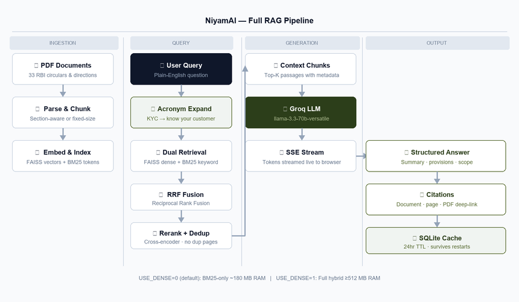
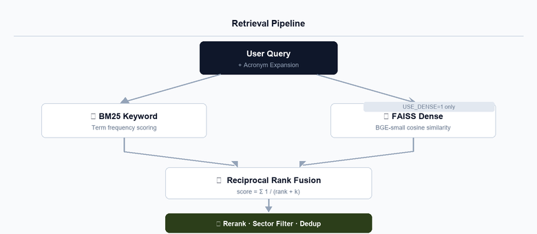
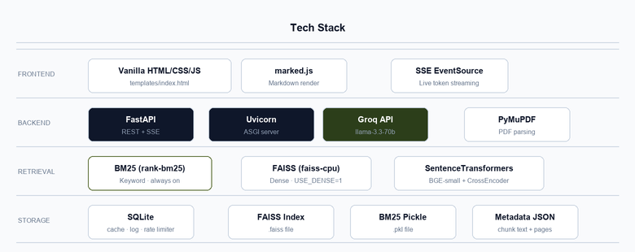

# NiyamAI

**Question-answering system over RBI regulations.** Ask plain-English questions and get precise, structured answers with citations to exact documents and pages.

## Architecture

NiyamAI is a RAG (Retrieval-Augmented Generation) system — it does not train a model. It uses pre-trained models for retrieval and a hosted LLM for generation.



### Retrieval Pipeline



## Tech Stack



| Layer | Technology |
|---|---|
| Backend | FastAPI + Uvicorn |
| Embedding | `BAAI/bge-small-en-v1.5` (skipped when `USE_DENSE=0`) |
| Vector DB | FAISS (local, skipped when `USE_DENSE=0`) |
| Keyword Search | BM25 (rank_bm25) with acronym expansion |
| Reranker | `cross-encoder/ms-marco-MiniLM-L-6-v2` (skipped when `USE_DENSE=0`) |
| LLM | Groq — configurable model, defaults to `llama-3.3-70b-versatile` |
| PDF Parsing | PyMuPDF |
| Cache + Rate Limiter | SQLite (persistent across restarts) |
| Frontend | Vanilla HTML/CSS/JS — editorial design, served from `templates/index.html` |

## Quick Start

```bash
# 1. Install dependencies
pip install -r requirements.txt

# 2. Set environment variables
cp .env.example .env
# Edit .env — set GROQ_API_KEY from https://console.groq.com/keys

# 3. Run ingestion (one-time — builds indexes from PDFs in ./Directories)
python -m src.ingestion

# 4. Start the server
python main.py
# or
uvicorn src.api:app --reload --host 0.0.0.0 --port 8000
```

Then open http://localhost:8000

## Environment Variables

| Variable | Default | Description |
|---|---|---|
| `GROQ_API_KEY` | required | Get from https://console.groq.com/keys |
| `GROQ_MODEL` | `llama-3.3-70b-versatile` | Groq model name |
| `USE_DENSE` | `0` | Set `1` to enable FAISS + reranker (requires ≥512 MB RAM) |
| `EMBEDDING_MODEL` | `BAAI/bge-small-en-v1.5` | Local embedding model |
| `RERANKER_MODEL` | `cross-encoder/ms-marco-MiniLM-L-6-v2` | Local reranker |
| `PDF_DIR` | `./Directories` | Source PDF folder |
| `CHUNKS_DIR` | `./data/chunks` | Where indexes are stored |
| `BM25_INDEX_PATH` | `./data/bm25_index.pkl` | BM25 index file |
| `CHUNKING_STRATEGY` | `section_aware` | `fixed` or `section_aware` |
| `CHUNK_SIZE` | `400` | Tokens per chunk (fixed mode) |
| `CHUNK_OVERLAP` | `80` | Token overlap between chunks |
| `RETRIEVAL_K` | `20` | Top-K per index before fusion |
| `RERANK_TOP_K` | `5` | Top-K after reranking (sent to LLM) |
| `API_HOST` | `0.0.0.0` | Server host |
| `API_PORT` | `8000` | Server port |

## API Endpoints

| Method | Endpoint | Description |
|---|---|---|
| GET | `/` | Frontend |
| POST | `/api/query` | Non-streaming query (SQLite-cached, 24hr TTL) |
| POST | `/api/query/stream` | SSE streaming query |
| GET | `/api/chunks/{index}` | Get chunk by index |
| GET | `/api/pdf/{doc_name}` | Serve original PDF for citation deep-linking |
| GET | `/health` | Health check — chunk count + cache size |
| GET | `/api/metrics` | Query log aggregates — latency, grounding, cache hit rate |

### Example Request

```bash
curl -X POST http://localhost:8000/api/query \
  -H "Content-Type: application/json" \
  -d '{"query": "What are the KYC norms for bank accounts?"}'
```

### Sector Filtering

Pass a `sector` field to scope retrieval to one regulatory domain:

```bash
curl -X POST http://localhost:8000/api/query \
  -H "Content-Type: application/json" \
  -d '{"query": "Fraud reporting timelines", "sector": "Fraud Risk Management"}'
```

Accepted sector values: `KYC`, `Digital Payment`, `Digital Banking`, `Fraud Risk Management`, `Priority sector lending` (case-insensitive, common aliases like `"fraud"` or `"psl"` also work).

## Retrieval Design

**Default (BM25-only, `USE_DENSE=0`):** Uses only BM25 keyword retrieval with acronym expansion. ~180 MB RAM. Suitable for Render free tier.

**Full hybrid (`USE_DENSE=1`):** FAISS dense retrieval + BM25 → Reciprocal Rank Fusion → cross-encoder reranking. Requires ≥512 MB RAM.

**Acronym expansion:** BM25 queries are automatically expanded — e.g., `"KYC"` becomes `"kyc know your customer"`, `"NBFC"` becomes `"nbfc non banking financial company"` — so BM25 matches passages that use the full term rather than the abbreviation.

**Deduplication:** Final results are deduplicated on `(doc_name, page)` so the same page from the same document never appears twice in citations.

## Grounding Score

The grounding score shown in the UI is a **lexical word-overlap** metric — it measures what fraction of meaningful words in the generated answer also appear in the retrieved passages. It is a relative signal, not a factual accuracy guarantee. A lower score may indicate the LLM introduced content not present in the source documents.

## Evaluation

```bash
python -m src.evaluation
```

Runs questions across 4 retrieval configs: `dense_only`, `bm25_only`, `hybrid`, `hybrid_rerank`. Metrics: Recall@5, MRR.

To get meaningful Recall@5 and MRR scores, populate `expected_chunk` in `data/eval_set.json` with the actual chunk index that best answers each question. Without ground-truth chunk IDs, only the generated answers can be reviewed qualitatively.

## File Structure

```
NiyamAI/
├── src/
│   ├── ingestion.py    # PDF parsing, chunking, embedding, indexing
│   ├── retrieval.py    # FAISS + BM25 + RRF + reranking + acronym expansion
│   ├── generation.py   # Groq LLM streaming with model fallbacks
│   ├── api.py          # FastAPI endpoints (SQLite cache + rate limiter)
│   ├── ui.py           # Template loader (reads templates/index.html)
│   └── evaluation.py   # Eval suite (4 retrieval configs)
├── templates/
│   └── index.html      # Frontend HTML/CSS/JS (edit here, not in ui.py)
├── data/
│   ├── chunks/
│   │   ├── metadata.json      # Chunk metadata (generated by ingestion)
│   │   └── faiss_index.faiss  # FAISS index (generated by ingestion)
│   ├── bm25_index.pkl         # BM25 index (generated by ingestion)
│   ├── cache.db               # SQLite: query cache + query log + rate limiter
│   └── eval_set.json          # Evaluation question set
├── Directories/        # Source PDFs organized by category
│   ├── KYC/
│   ├── Digital Banking/
│   ├── Digital Payment/
│   ├── Fraud Risk Management/
│   └── Priority sector lending/
├── .env                # API keys and config (never commit)
├── main.py             # Entry point
├── requirements.txt
├── Dockerfile
├── render.yaml
└── README.md
```

## Deployment

### HuggingFace Spaces (recommended — always-on, free)

1. Create a new Space at [huggingface.co/new-space](https://huggingface.co/new-space) — SDK: `Docker`
2. Add HF as a git remote and push:
   ```bash
   git remote add hf https://huggingface.co/spaces/YOUR_HF_USERNAME/NiyamAI
   git push hf main
   ```
3. In your Space → **Settings → Variables and Secrets**, add:
   - `GROQ_API_KEY` — your Groq API key (the only required secret)
4. HF builds the Docker image automatically. App will be live at `https://YOUR_HF_USERNAME-niyamai.hf.space`

> HF CPU spaces give 16 GB RAM — enough to run `USE_DENSE=1` for full hybrid retrieval.

### Docker (local or any VPS)

```bash
docker build -t niyamai .
docker run -p 7860:7860 --env-file .env niyamai
```

### Render / Railway

1. Connect your GitHub repo
2. Set env vars: `GROQ_API_KEY` (required)
3. Start command: `uvicorn src.api:app --host 0.0.0.0 --port $PORT`

> Pre-built indexes in `data/` are committed to the repo. Default BM25-only mode (`USE_DENSE=0`) uses ~180 MB RAM.

## Features

- **Hybrid retrieval** — Dense (FAISS) + Keyword (BM25) + RRF fusion
- **Acronym expansion** — BM25 queries automatically expand RBI-domain abbreviations (KYC, NBFC, UPI, PSL, etc.)
- **Cross-encoder reranking** for precision (when `USE_DENSE=1`)
- **Sector filtering** — scope queries to one regulatory domain; case-insensitive with alias support
- **Citation deduplication** — same page never appears twice in results
- **Streaming answers** via Server-Sent Events
- **Source citations** with document name, page number, and direct PDF link
- **SQLite cache** — 24hr TTL, survives restarts
- **SQLite rate limiter** — 40 req/min per IP, survives restarts
- **Query metrics** — latency, grounding score, cache hit rate via `/api/metrics`
- **Multi-turn conversations** — follow-up questions with conversation history
- **Query history** — persisted in localStorage
- **Editable frontend** — HTML/CSS/JS lives in `templates/index.html`
